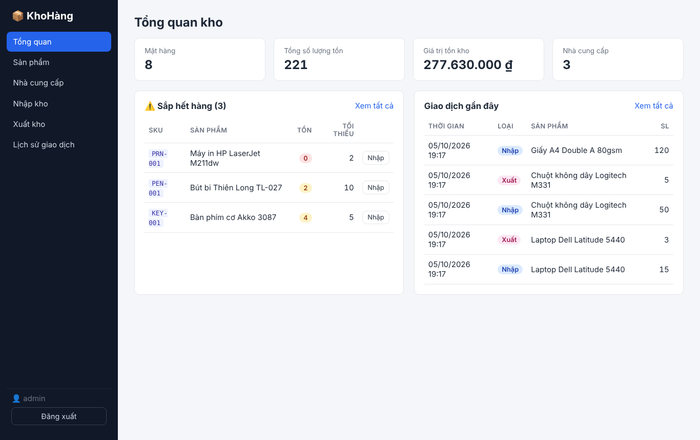

# 📦 Hệ thống Quản lý Kho hàng (Inventory) – Triển khai & Quản trị

Đề tài 5 – Môn **Triển khai và Quản trị Hệ thống Phần mềm**

Website quản lý kho (nhập/xuất hàng, tồn kho, nhà cung cấp) triển khai trên **Ubuntu Server 24.04 LTS**, toàn bộ dịch vụ chạy bằng **Docker Compose**:

| Thành phần | Công nghệ | Truy cập |
|---|---|---|
| Web app | Python Flask + Gunicorn | https://localhost/ |
| Database | MySQL 8.0 | (chỉ mạng nội bộ) |
| Công cụ quản lý DB | phpMyAdmin 5.2 | https://localhost/phpmyadmin/ |
| Reverse proxy | Nginx 1.27 (unprivileged), HTTPS tự ký | cổng 80 → 443 |
| Giám sát | Prometheus + Grafana + cAdvisor + node/mysqld/nginx exporter | https://localhost/grafana/ · Prometheus qua SSH tunnel |
| Log tập trung | Loki + Promtail | Grafana → Explore → Loki |



## Mô hình triển khai

```
 Máy Windows (trình duyệt, PowerShell/SSH)
      │  VMware Workstation NAT (VMnet8) port forwarding
      │  localhost:443 → 443   localhost:80 → 80   localhost:2222 → 22
      ▼
 Máy ảo Ubuntu Server 24.04 LTS (IP tĩnh 192.168.X.10; 2 vCPU, 4 GB RAM, 30 GB) · UFW: 22/80/443
      └── Docker Engine + Compose plugin ── 12 container (bên dưới)
```

## Kiến trúc container

```
                   Trình duyệt
                        │ 80 (→301) / 443 (TLS)
                ┌───────▼────────┐
                │     Nginx      │  security headers, rate-limit, HTTPS
                └─┬─────┬──────┬─┘
    ┌─────────────┘     │      └──────────────┐          [frontend]
┌───▼───────┐    ┌──────▼─────┐        ┌──────▼──────┐
│  Web app  │    │ phpMyAdmin │        │   Grafana   │
│  (Flask)  │    └──────┬─────┘        └──┬───────┬──┘
└─────┬─────┘           │                 │       │
      │   [backend - internal]            │       │   [monitoring]
      └─────────┬───────┘          ┌──────▼───┐ ┌─▼────┐
           ┌────▼────┐             │Prometheus│ │ Loki │◄── Promtail ◄── log mọi container
           │  MySQL  │◄── mysqld-  └────┬─────┘ └──────┘
           └─────────┘    exporter      │ scrape
                          cAdvisor, node-exporter, nginx-exporter, app /metrics
```

## Yêu cầu

- Ubuntu Server 22.04/24.04 LTS (máy ảo hoặc máy thật), tối thiểu 2 vCPU, 4 GB RAM, 30 GB đĩa
- Docker Engine + Docker Compose plugin (cài từ https://get.docker.com)
- Cổng 80 và 443 trên server đang trống

## Chạy nhanh (trên server)

```bash
git clone git@github.com:<MSSV>/inventory-system.git
cd inventory-system

bash scripts/gen-env.sh      # sinh .env với mật khẩu mạnh ngẫu nhiên
bash scripts/gen-cert.sh     # sinh chứng chỉ HTTPS tự ký

# Gộp cả 3 file compose để các lệnh docker compose ngắn gọn
echo 'COMPOSE_FILE=docker-compose.yml:docker-compose.monitoring.yml:docker-compose.logging.yml' >> .env

docker compose up -d --build
docker compose ps            # chờ db, app, nginx "healthy"
```

Chạy từng phần (đúng thứ tự 3 commit):

| Phần | Lệnh |
|---|---|
| 1. App + DB + Nginx | `docker compose up -d --build` |
| 2. + Giám sát | `docker compose -f docker-compose.yml -f docker-compose.monitoring.yml up -d` |
| 3. + Log tập trung | `docker compose -f docker-compose.yml -f docker-compose.monitoring.yml -f docker-compose.logging.yml up -d` |

## Đăng nhập

Mật khẩu nằm trong file `.env` trên server (được in ra khi chạy `gen-env.sh`; xem lại bằng `cat .env`).

| Dịch vụ | URL (mở trên trình duyệt Windows) | Tài khoản |
|---|---|---|
| Web app | https://localhost/ | `ADMIN_USERNAME` / `ADMIN_PASSWORD` |
| phpMyAdmin | https://localhost/phpmyadmin/ | `APP_DB_USER` / `APP_DB_PASSWORD` (root bị chặn đăng nhập từ xa) |
| Grafana | https://localhost/grafana/ | `GRAFANA_ADMIN_USER` / `GRAFANA_ADMIN_PASSWORD` |
| Prometheus | http://localhost:9090/targets | Chỉ bind `127.0.0.1` trên server → mở SSH tunnel: `ssh -p 2222 -L 9090:127.0.0.1:9090 <user>@localhost` |

Trình duyệt sẽ cảnh báo chứng chỉ tự ký → chọn *Advanced → Proceed to localhost*.

> Nếu dùng cổng khác (vd. 8443), đặt `PUBLIC_URL=https://localhost:8443` trong `.env` rồi chạy lại `docker compose up -d`.

## Cấu trúc thư mục

```
├── docker-compose.yml              # Phần 1: app, db, phpmyadmin, nginx
├── docker-compose.monitoring.yml   # Phần 2: prometheus, grafana, exporters
├── docker-compose.logging.yml      # Phần 3: loki, promtail
├── .env.example                    # mẫu biến môi trường (.env thật KHÔNG commit)
├── app/                            # mã nguồn web app Flask + Dockerfile (non-root)
├── db/init/                        # schema + dữ liệu mẫu + tạo user DB quyền tối thiểu
├── nginx/                          # nginx.conf, virtual host, security headers, certs/
├── monitoring/prometheus/          # prometheus.yml, alert.rules.yml
├── monitoring/grafana/             # provisioning datasource + dashboard JSON
├── logging/                        # loki-config.yml, promtail-config.yml
├── scripts/                        # gen-env.sh, gen-cert.sh
└── docs/HUONG_DAN.md               # hướng dẫn từng bước trên Ubuntu Server, LogQL, hardening, báo cáo
```

## Truy vấn LogQL mẫu

```logql
{service="app"} | logfmt | event="stock_out"                       # các phiếu xuất kho
{service="app"} | logfmt | event="login_failed"                    # đăng nhập thất bại
{service="nginx"} | json | status >= 400                           # request lỗi qua Nginx
sum by (status_class) (count_over_time({service="nginx", status_class=~".+"}[5m]))  # request theo 2xx/3xx/4xx/5xx
topk(5, sum by (uri) (count_over_time({service="nginx", stream="stdout"} | json | __error__="" [15m])))  # top 5 URL
```

## Các biện pháp hardening

**Mức container / ứng dụng**
- Container chạy **non-root** (app UID 10001, nginx UID 101, Prometheus/exporter `nobody`, Grafana 472, Loki 10001)
- `read_only` filesystem, `cap_drop: ALL`, `no-new-privileges`, giới hạn RAM/PIDs, xoay vòng log
- **Network isolation**: `backend` là mạng `internal` – MySQL không publish port, không ra Internet
- Chỉ Nginx mở cổng 80/443; Prometheus chỉ bind `127.0.0.1`
- Mật khẩu mạnh sinh ngẫu nhiên trong `.env` (đã `.gitignore`)
- **Hạn chế quyền DB**: app chỉ có `SELECT/INSERT/UPDATE/DELETE`; exporter chỉ đọc thống kê; root chỉ login từ localhost
- Nginx: HTTPS (TLS 1.2/1.3), HTTP→HTTPS, HSTS, CSP, X-Frame-Options, X-Content-Type-Options, Referrer-Policy, ẩn version, rate-limit trang login, chặn `/metrics`
- App: mật khẩu hash, CSRF token, cookie `Secure/HttpOnly/SameSite`, chống open-redirect, khoá dòng khi xuất kho

**Mức hệ điều hành (Ubuntu Server)**
- Tường lửa UFW chỉ mở 22/80/443; VMware chỉ chuyển tiếp đúng 3 cổng này vào máy ảo
- Đăng nhập GitHub bằng SSH key, SSH không cho root đăng nhập bằng mật khẩu (mặc định Ubuntu)
- Tự động cập nhật bản vá bảo mật (`unattended-upgrades`)

Chi tiết từng bước và cách kiểm chứng: xem [docs/HUONG_DAN.md](docs/HUONG_DAN.md).

## Dừng / xoá

```bash
docker compose down      # dừng (dữ liệu vẫn giữ trong volume)
docker compose down -v   # dừng + xoá toàn bộ dữ liệu (DB, Prometheus, Grafana, Loki)
```

(Các lệnh trên áp dụng cho cả 3 file khi đã đặt `COMPOSE_FILE` trong `.env`.)
